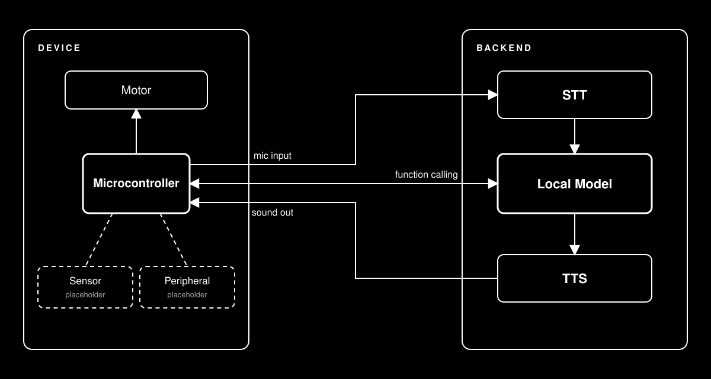

# LLM Embodiments

A voice-controlled LLM system for prototyping physical "Large Language Objects" with devices connected over Serial, BLE, or WiFi.



## Install

### Before you start

You will need an internet connection to download the project, Python packages,
and the Ollama model. Install Git so you can clone the repository:

- **Windows:** install [Git for Windows](https://git-scm.com/download/win).
- **macOS:** open Terminal and run `git --version`. If macOS offers to install
  Command Line Developer Tools, accept. Otherwise, install Git from
  [git-scm.com](https://git-scm.com/download/mac).
- **Linux:** Git is often already installed. On Ubuntu or Debian, install it
  with `sudo apt install git` if needed.

The setup script creates a separate Python environment for this project, so
you do not need to install Python packages yourself. It uses Python 3.13 where
available:

- **Windows:** setup can install Python using `winget`. If you do not have
  `winget`, install Python 3.13 from
  [python.org](https://www.python.org/downloads/windows/) and select **Add
  python.exe to PATH** in the installer. You may need to close and reopen
  PowerShell after installing Python.
- **macOS:** setup installs Python 3.13 with Homebrew. It can install Homebrew
  if needed; follow any prompts for Command Line Developer Tools or your
  administrator password.
- **Linux:** setup installs Python and required system libraries on
  Debian/Ubuntu. It may ask for your `sudo` password. Other Linux
  distributions are not covered by the automatic installer; see
  [Manual installation](MANUAL_INSTALL.md).

On macOS and Linux, run setup as your normal user, **not** with `sudo`.

### Get the project

Open a terminal (PowerShell on Windows), then clone the repository:

```bash
git clone https://github.com/IAD-ZHDK/LLM_embodiments.git
cd LLM_embodiments
```

### Set up Python

**macOS and Linux** (Debian/Ubuntu):

```bash
chmod +x setup.sh run.sh
./setup.sh
```

**Windows:** open PowerShell in the project folder and run:

```powershell
powershell -ExecutionPolicy Bypass -File .\setup.ps1
```

Setup creates the Python environment, installs the dependencies, and downloads
the speech voices. If it installs Python on Windows, reopen PowerShell and run
the setup command again.

### Install Ollama and download the model

Ollama runs the default language model on your computer. Install it from
[ollama.com](https://ollama.com/download) (use the Windows download on Windows),
then open a new terminal and download the model:

```powershell
ollama pull gemma4:e4b
```

If the `ollama` command is not found, finish installing Ollama and reopen your
terminal. If setup asks for an OpenAI API key and you are using Ollama, press
Enter to skip.

### Start the backend

On macOS or Linux:

```bash
./run.sh
```

On Windows, from PowerShell in the project folder:

```powershell
powershell -ExecutionPolicy Bypass -File .\run.ps1
```

The default provider and model are `ollama` and `gemma4:e4b`. See
[config.toml](config.toml) to change them.

For manual dependency installation, speech-model setup, or OpenAI configuration, see [Manual installation](MANUAL_INSTALL.md).

To update an existing checkout, run `git pull` from the repository folder.
